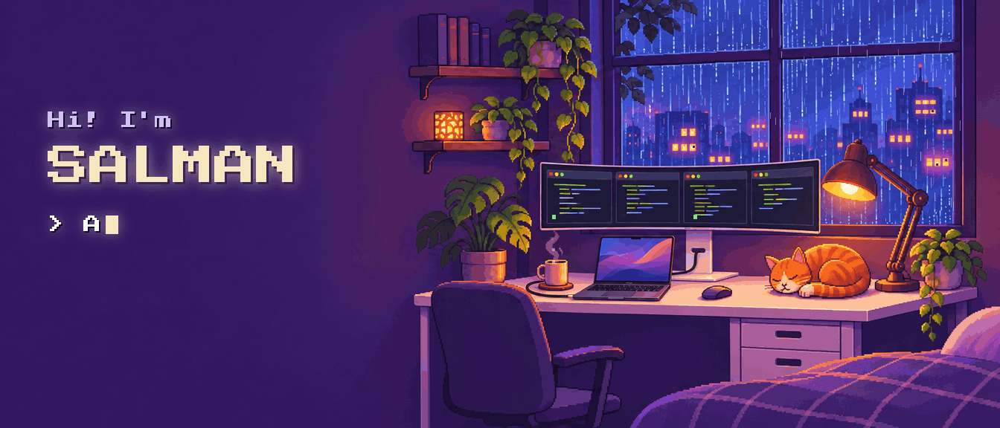

 

 

### 🌊 What I'm building

**Selami** turns elementary math into an ocean adventure: islands to conquer, a guide octopus named Okto, battles with friends, and exam prep for Indonesia's TKA. Live on Google Play and the App Store.

- 🐙 850+ bite-sized lessons and 7,400+ illustrated questions
- ⚔️ Real-time math battles and ranked leagues
- 🤖 An AI tutor that learns from the student explaining back to it
- 🎬 A content studio run with AI agents: Roblox stories, motion ads, what-if shorts

 

### 🛠️ Tools I ship with

  

 

### 📈 Activity

  

  <picture>
    <source media="(prefers-color-scheme: dark)" srcset="https://raw.githubusercontent.com/salmakkiy/salmakkiy/output/github-snake-dark.svg" />
    <source media="(prefers-color-scheme: light)" srcset="https://raw.githubusercontent.com/salmakkiy/salmakkiy/output/github-snake.svg" />
    
  </picture>

