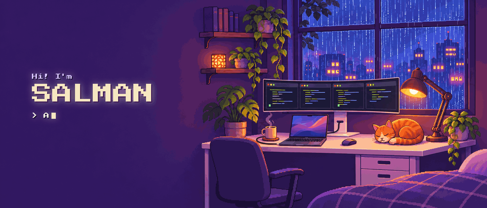

 

 

## About Me

🐙 **Founder of [Selami](https://selami.id)**, a math learning app for elementary students in Indonesia  
📱 Live on **Google Play** and the **App Store**  
🧮 **850+ lessons** and **7,400+ illustrated questions**, from grade 1 to TKA exam prep  
⚔️ Built **real-time math battles** and **ranked leagues** so practice feels like a game  
🤖 **AI enthusiast**, building with **Claude** and AI agents every day  
🎬 Running Selami's content: **Roblox stories**, motion ads, and what-if shorts  

---

## Tech Stack

### 💻 Languages

### 🌐 Web & App

### 🤖 AI

### 🎮 Creative

---

## Activity

  

  <picture>
    <source media="(prefers-color-scheme: dark)" srcset="https://raw.githubusercontent.com/salmakkiy/salmakkiy/output/github-snake-dark.svg" />
    <source media="(prefers-color-scheme: light)" srcset="https://raw.githubusercontent.com/salmakkiy/salmakkiy/output/github-snake.svg" />
    
  </picture>

---

## Let's Connect!

