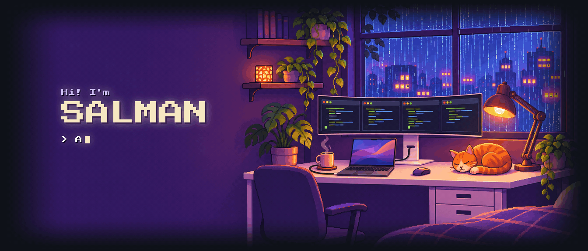

 

&nbsp;&nbsp;

 

## About Me

🎓 Incoming **Computer Science** student at **The University of Melbourne** ('29)  
🏅 **LPDP Garuda Scholarship** awardee  
🏆 Medalist in national & international **Math** and **Informatics Olympiads**  
🐙 Founder of **[Selami](https://selami.id)**, a math app that makes kids actually want to practice  

---

---

## Activity

  

  <picture>
    <source media="(prefers-color-scheme: dark)" srcset="https://raw.githubusercontent.com/salmakkiy/salmakkiy/output/pacman-contribution-graph-dark.svg?v=2" />
    <source media="(prefers-color-scheme: light)" srcset="https://raw.githubusercontent.com/salmakkiy/salmakkiy/output/pacman-contribution-graph.svg?v=2" />
    
  </picture>

